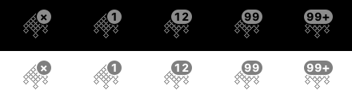
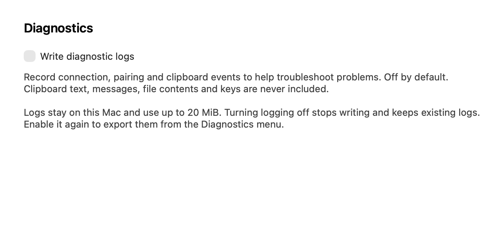

# Soduto — hidoba fork

A macOS KDE Connect client focused on clipboard sync, pairing, connection recovery,
and useful diagnostics. This fork combines the upstream `fix/network-reliability`
and `feat/refine-services` branches, with additional fixes for those connection paths.

**Current release: [3.2.1 (build 29)](https://github.com/hidoba/Soduto/releases/tag/v3.2.1)**

[Download the macOS app](https://github.com/hidoba/Soduto/releases/download/v3.2.1/Soduto-3.2.1-29-macos-universal.zip)
· [SHA-256 checksum](https://github.com/hidoba/Soduto/releases/download/v3.2.1/Soduto-3.2.1-29-macos-universal.zip.sha256)
· [Release notes](docs/releases/3.2.1.md)

This is an **unsigned, unnotarized pre-release** for **macOS 14 or newer**, with a
universal **Apple Silicon (`arm64`) and Intel (`x86_64`)** executable. Automated
checks and the full Release build pass; real-device Ubuntu clipboard, pairing,
sleep/wake, and Wi-Fi recovery testing remains pending.

## What changed

### Clipboard

- Keep observing local copies while disconnected, so a new offline copy is not
  replaced by older text when a peer reconnects.
- Check for copies between timer ticks before comparing reconnect timestamps.
  Non-text copies also advance freshness, protecting newly copied images and files.
- Prevent identical text and previously seen generations from circulating through
  multiple peers. Forward fresh generations across a hub even when it already has
  that text, without rewriting the pasteboard.
- Preserve other pasteboard representations when the text is already identical.
- Give rapid copies increasing timestamps, converge simultaneous edits, and allow
  deliberately copying earlier text again. Ordinary KDE Connect clipboard packets
  remain live edits regardless of the sender's clock.
- Refresh negotiated clipboard capabilities and service dispatch after reconnects,
  and discard obsolete queued clipboard copies.

### Pairing and reconnects

- Support KDE Connect protocol versions **7 and 8**, including v8 request timestamp
  validation and certificate-based verification codes.
- Require the peer's TLS certificate before pairing can succeed. Ignore duplicate
  confirmations without creating reply loops; fresh re-pair requests ask for approval.
- Cancel unfinished pairing requests and timers on disconnect while preserving
  established certificate pins during ordinary connection loss.
- Keep competing connections and queued results from invalidating a verification
  prompt. Superseded sockets cannot apply delayed clipboard or unpair packets.
- Process connection, packet, and pairing callbacks in order on the main queue,
  including the handoff before the first service packet arrives.
- Reset old connections after wake and network changes. Connection initialization
  has a **10-second deadline**, with its last phase recorded if it times out.

### Connection badge

The existing menu bar icon now has a **small badge over its upper-right corner**.
It keeps the original square width and updates without opening the menu.

| Paired, reachable devices | Badge |
| --- | --- |
| None | `×` |
| 1–99 | The connected count |
| 100 or more | `99+` |

Hover over the icon for the full count. The badge counts connected, paired devices,
not discovery results or individual sockets. Its tooltip and accessibility label
also update with the connection state.



Examples above: `×`, `1`, `12`, `99`, and `99+`. The image was rendered with native
AppKit using the actual badge drawing code.

### Persistent diagnostics

**Write diagnostic logs is off by default.** Enable it in
**Preferences → Diagnostics → Write diagnostic logs** or the
**Diagnostics → Write diagnostic logs** menu item. Both controls share the same
saved setting. No diagnostic journal is created or appended automatically while
the setting is off. Turning it off drains pending writes and closes the log file;
existing logs are kept. Your choice is remembered across launches.

The **Diagnostics** menu sits directly **above Quit**. Export, open-log-folder and
detailed-packet-logging actions are disabled while writing is off; **Reconnect
All Devices** stays available. To export older logs, enable writing again first.
Ordinary macOS Console logging is separate from this diagnostic journal.



The **Diagnostics** menu provides **Export Diagnostic Bundle…**, **Open Diagnostic
Logs**, **Detailed Packet Logging**, and **Reconnect All Devices**.

- A rotating JSON journal retains **four files of up to 5 MiB each** across restarts.
- Events include sleep/wake, network changes, discovery, TCP/TLS handshakes, pairing,
  packet dispatch, clipboard decisions, and transfer completion or failure.
- Session, connection, and temporary device aliases let related events be followed
  through the timeline. Exports include a runtime snapshot.
- The journal excludes packet bodies, clipboard text, notifications, filenames,
  file contents, IP/MAC addresses, certificates, and private keys. Clipboard replay
  fingerprints stay in bounded memory and are never logged. No logs are uploaded.

To capture a problem, enable log writing, reproduce the issue, and export a bundle
**before** using **Reconnect All Devices**. You can then turn log writing off again.
See [diagnostics and testing](docs/diagnostics.md) for the event guide, storage
locations, privacy details, and real-device test checklist.

## Validation and compatibility

**53 automated checks pass**, alongside a complete Release build of the app and
extensions on macOS 26:

| Checks | Count | Coverage |
| --- | ---: | --- |
| Native reliability tests | 18 | Clipboard state, recovery policy, journal privacy, persistence, rotation, and ZIP export |
| Clipboard integration scenarios | 13 | Offline copies, reconnect freshness, legacy clients, direction settings, and multi-peer relays |
| Pairing/transport integration scenarios | 16 | Protocol 7/8, verification hashes, certificates, interrupted requests, dispatch, and stale prompts |
| Diagnostic settings scenarios | 6 | Default-off behavior, persistence, concurrent stop, menu placement, UI synchronization, and disabled controls |
| **Total** | **53** | |

[Verified build and checks](https://github.com/hidoba/Soduto/actions/runs/39863950882)
· [Built source revision: `5c0254f`](https://github.com/hidoba/Soduto/commit/5c0254f38a44bcdd7f2c87f64956bf4a43e4d006)

The downloaded archive's checksum, universal executable, version **3.2.1 (29)**,
fork bundle ID, source revision, and update settings were verified. The menu badge
was also compiled and rendered in light and dark appearances.

The clipboard/pairing scenarios use fake clipboard, transport, certificate storage,
and windows; diagnostic settings scenarios use isolated preferences and temporary
journal files. They do not exercise the actual Ubuntu peer. The reported target setup is
Ubuntu GNOME/Wayland with KDE Connect **25.12.3**. End-to-end compatibility and repeated
sleep/Wi-Fi recovery with that setup still need real-device validation. GNOME/Wayland
clipboard integration also depends on the Linux desktop; see the diagnostic guide.
Protocol support is not a guarantee that every inherited service works with every
KDE Connect client. The additional fixes here focus on clipboard, pairing, and their
shared connection lifecycle.

## Download and install

1. Download the ZIP and matching `.sha256` file from
   [release 3.2.1 (29)](https://github.com/hidoba/Soduto/releases/tag/v3.2.1).
2. In the directory containing both downloads, verify the archive:

   ```sh
   shasum -a 256 -c Soduto-3.2.1-29-macos-universal.zip.sha256
   ```

3. Extract the ZIP and move `Soduto.app` into Applications. This prebuilt app is
   unsigned and not notarized; macOS may block it. For a development-signed build,
   use Xcode with your own Apple Developer team as described below.
4. Quit the running copy and other Mac KDE Connect/Soduto clients before updating
   or testing. A first install of this fork pairs as a new Mac device; updates of
   this fork preserve its existing pairing and preferences.

The fork uses bundle ID **`com.hidoba.Soduto`**, with its own preferences and
keychain identity names. Automatic upstream Sparkle updates are disabled. Use
**Fork Releases on GitHub…** in the app for manual updates from
[our releases](https://github.com/hidoba/Soduto/releases).

The checksum verifies download integrity; it is not a code-signing or notarization
claim. Additional CI artifacts remain available from [GitHub Actions](https://github.com/hidoba/Soduto/actions/workflows/build.yml).

## Build and run the checks

Use **Xcode 26 or newer**. Clone this fork's default development branch:

```sh
git clone --branch codex/reliability-diagnostics https://github.com/hidoba/Soduto.git
cd Soduto
cp LocalConfig.xcconfig.example LocalConfig.xcconfig
open Soduto.xcodeproj
```

Set your `DEVELOPMENT_TEAM` in the untracked `LocalConfig.xcconfig`; keep the fork's
bundle ID. Let Xcode resolve the Swift package dependencies, then build the
`Soduto` scheme. Local signing settings belong in that file rather than the shared
project file.

Run the regression checks with the Xcode toolchain selected:

```sh
swift test
python3 scripts/test-clipboard-service.py
python3 scripts/test-pairing-transport.py
python3 scripts/test-diagnostics-settings.py
```

The [build workflow](.github/workflows/build.yml) contains the complete unsigned
Release build and packaging commands. The historical certificate tests are not
run there because they modify the user's default keychain.

## Upstream work and attribution

This fork integrates:

- [`fix/network-reliability` at `ca7db3a`](https://github.com/sannidhyaroy/Soduto/commit/ca7db3a): connection and discovery recovery work.
- [`feat/refine-services` at `afcc62d`](https://github.com/sannidhyaroy/Soduto/commit/afcc62d): service and interface refinements.

The inherited application includes notifications, file sharing/SFTP, battery and
connectivity reporting, media/volume controls, remote input, commands, and other
KDE Connect services. See the [upstream project](https://github.com/sannidhyaroy/Soduto)
for its broader feature documentation. Inclusion here does not mean those services
were all fixed or validated in this clipboard/pairing work.

Thanks to [sannidhyaroy/Soduto](https://github.com/sannidhyaroy/Soduto) and the
original [soduto/Soduto](https://github.com/soduto/Soduto). Their copyright and
attribution remain in place. Soduto is distributed under the [GNU GPL v3](LICENSE).
